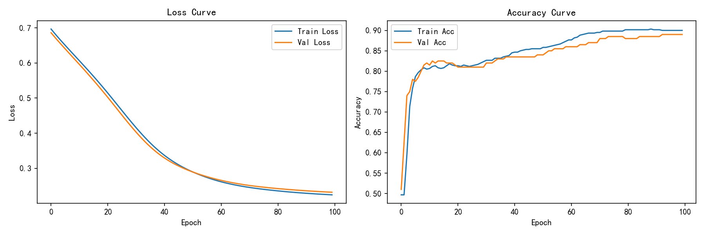
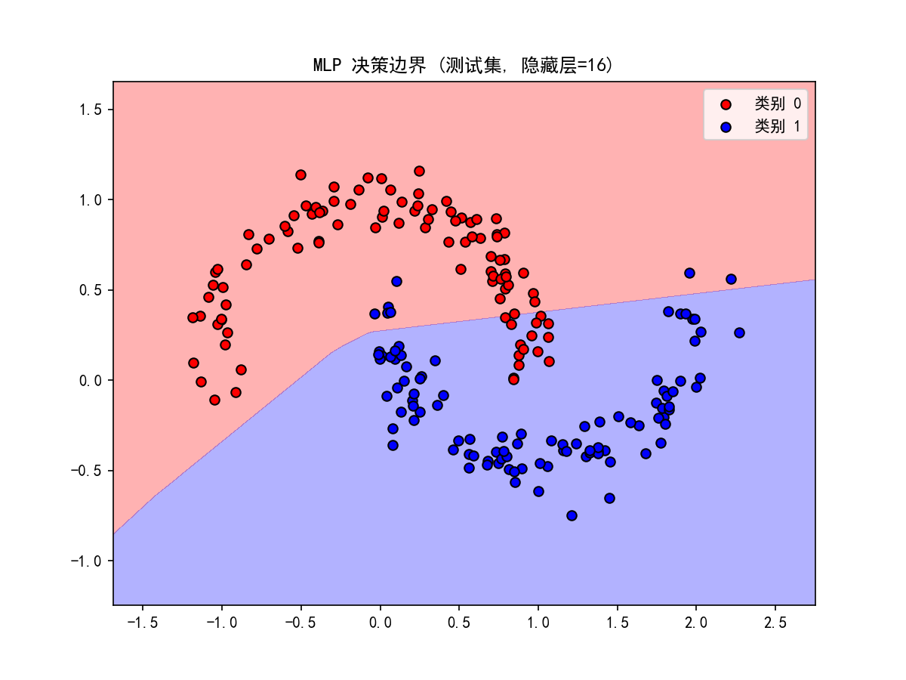
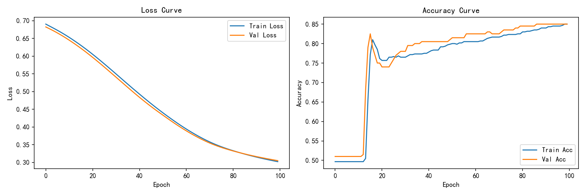
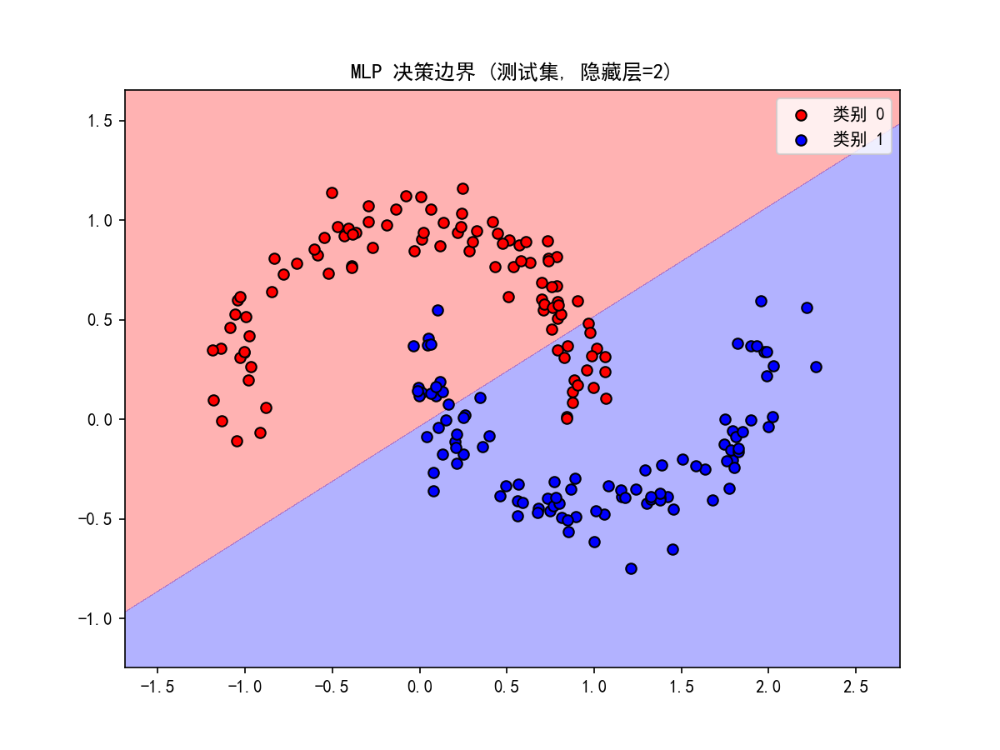
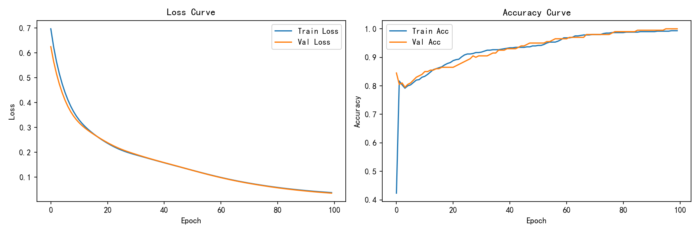
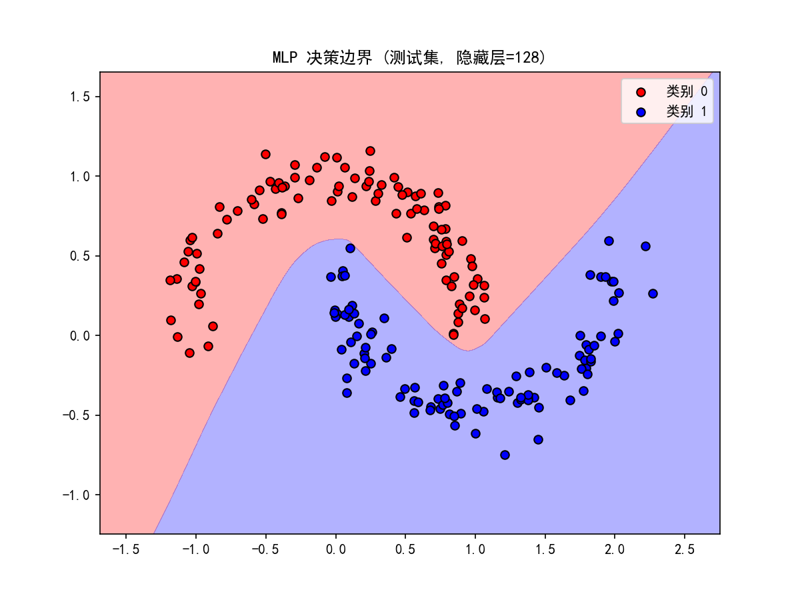

# Task 1: 简单神经网络 (MLP) 实验报告

## 1. 数据集与任务
使用 `make_moons` 生成二分类数据，线性不可分，因此必须使用带激活函数的 MLP。

## 2. 实验设置
- 数据划分：6:2:2 (训练/验证/测试)
- 优化器：Adam，学习率 0.01
- 损失函数：BCE Loss (二分类交叉熵)
- 激活函数：ReLU (隐藏层)，Sigmoid (输出层)

## 3. 对照实验：隐藏层宽度的影响
我分别测试了隐藏层大小为 2、16、128 的情况。

| 隐藏层宽度 | 测试集准确率 | 决策边界形状 | Loss 曲线 | 结论 |
| :--- | :--- | :--- | :--- | :--- |
| 2 | ~83.5% | 近乎直线 | 最终 ~0.30 | **欠拟合**：参数太少，学不会非线性特征 |
| 16 | ~89% | 有折角的曲线 | 最终 ~0.23 | **良好拟合**：性价比最高，泛化好 |
| 128 | 100% | 极其平滑复杂 | 最终 ~0.20 | **潜在过拟合**：参数是数据特征的几十倍，容易死记硬背 |

## 4. 思考题回答
- **为什么选择 ReLU 和 Sigmoid？** 
- ReLU 首先引入非线性变换，若没有非线性激活，多层网络等价于单层线性模型，无法拟合 make_moons 这种线性不可分数据，其次该函数在正区间梯度为1，能有效缓解梯度消失，适合隐藏层；
- Sigmoid 可以将输出压缩到 (0,1)，把输出解释为样本属于正类的概率，适配二分类任务，也能与 BCE 损失搭配使用。
- **optimizer.zero_grad(), loss.backward(), optimizer.step() 的作用？** 
`optimizer.zero_grad()`：清空上一轮迭代遗留的梯度，防止梯度累加干扰本次计算；
`loss.backward()`：反向传播，自动计算损失函数对网络所有权重、偏置的梯度；
`optimizer.step()`：优化器根据计算得到的梯度，沿着梯度反方向（即损失下降方向）更新参数w和d，以缩小误差。（通常\(w_{new}=w_{old}-\eta\cdot \frac{\partial loss}{\partial w}\)）
- **更深更宽一定更好吗？** 
- 不是。网络宽度不足时参数容量有限，会发生欠拟合（如隐藏层宽度 H=2），无法学习数据的非线性模式；宽度过大时模型参数量暴增，模型记忆训练集噪声，带来过拟合风险（如 H=128），同时增大计算开销。模型容量需要和数据复杂度匹配，寻找泛化能力与拟合能力的平衡点。

## 5. 实验图表
### 隐藏层=16 (基线)

### 隐藏层=2 (欠拟合)

### 隐藏层=128 (潜在过拟合)

