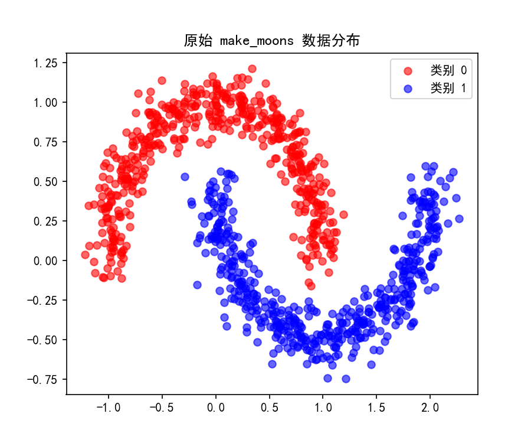
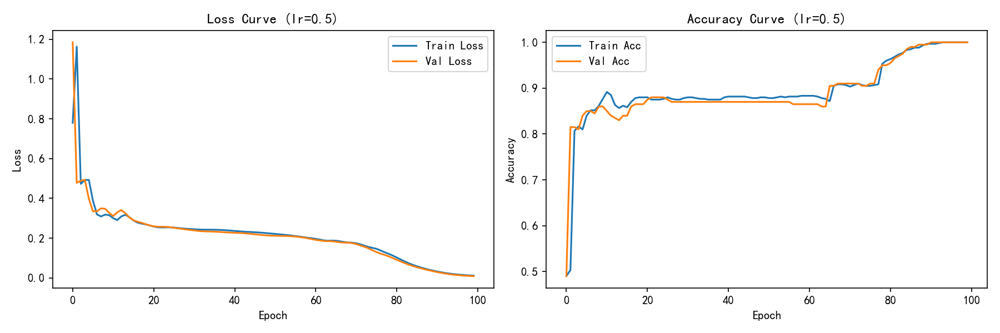
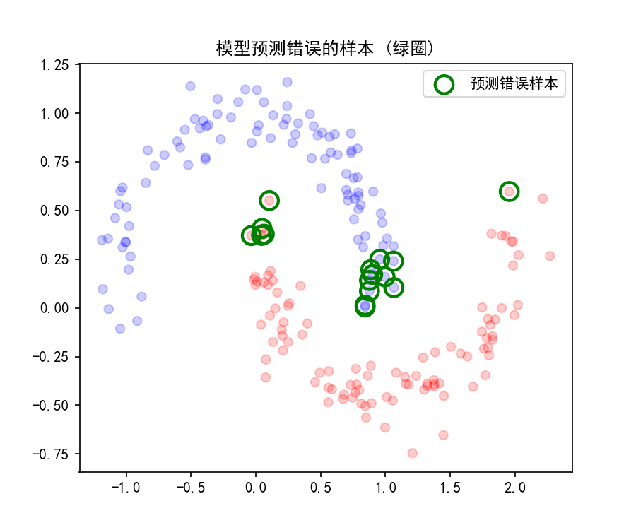
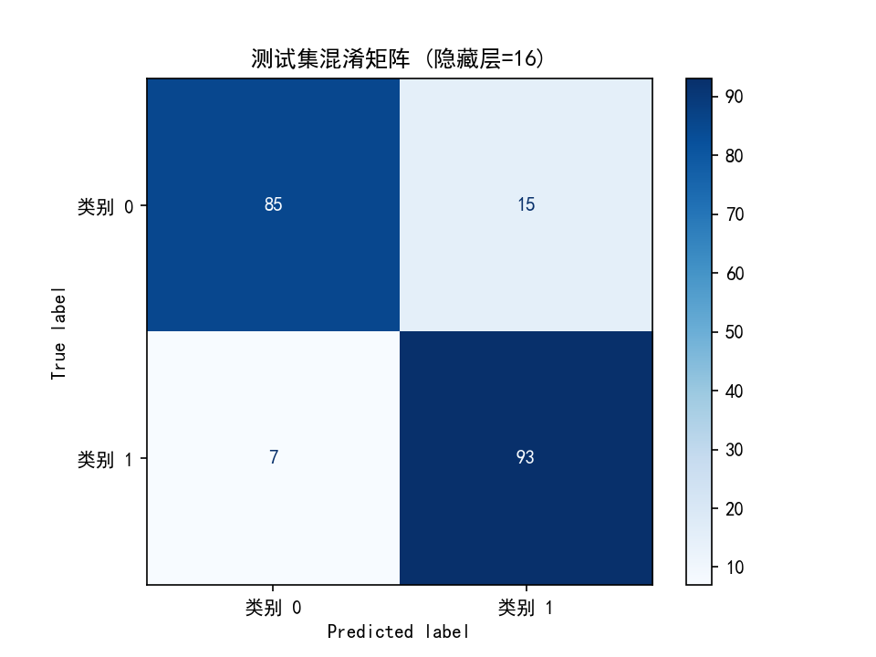
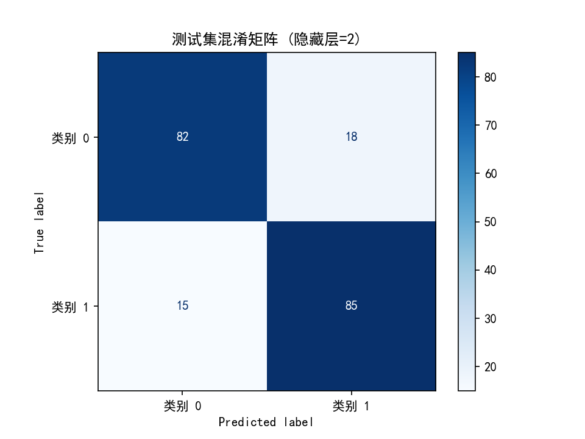
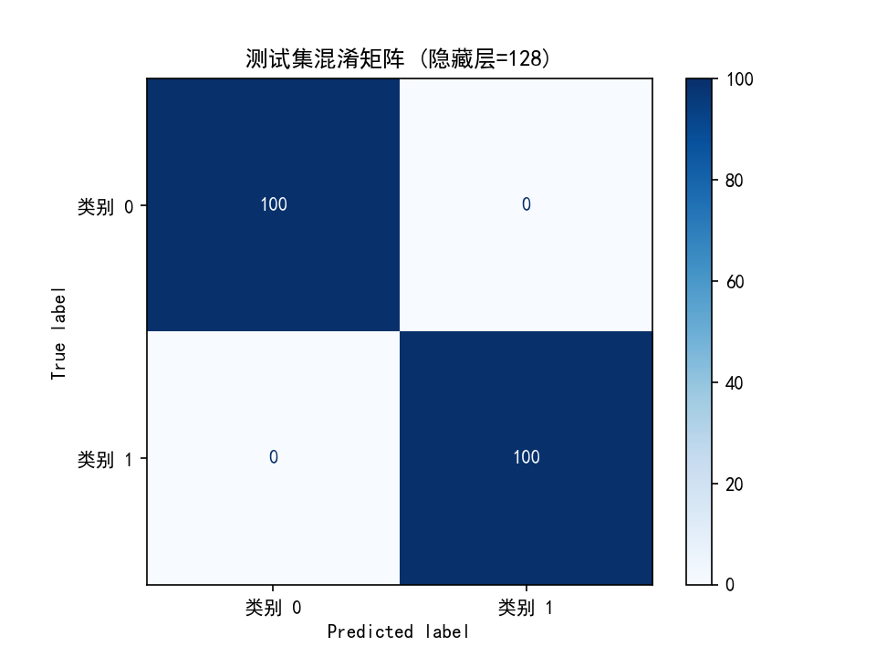
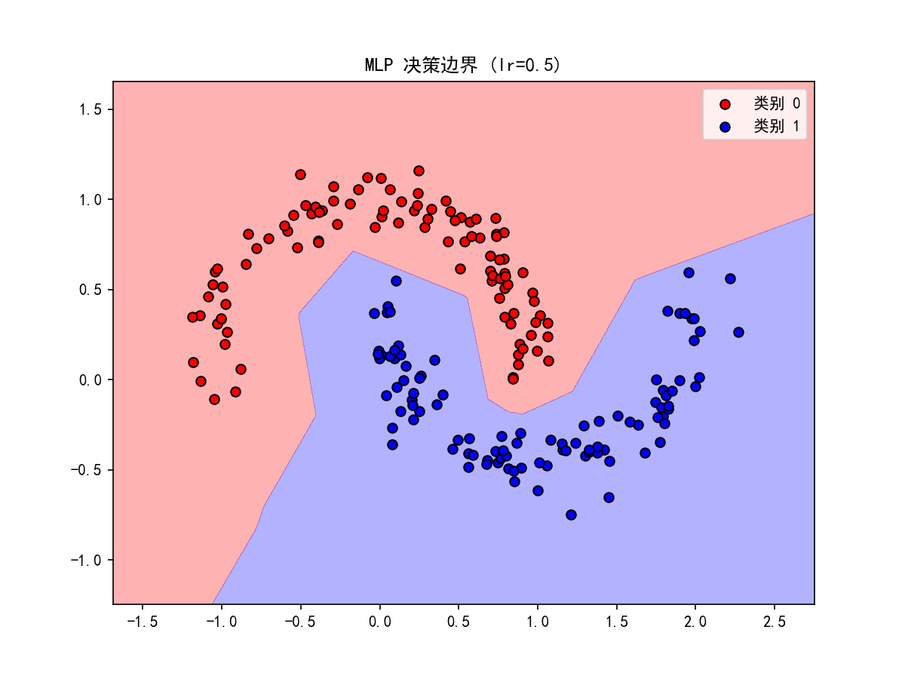
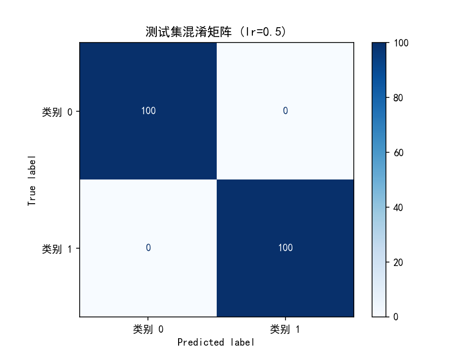

# Task 1: 简单神经网络 (MLP) 实验报告

## 1. 数据集与任务划分
使用 `make_moons` 生成了 1000 个带噪声（noise=0.1）的二分类半月形数据。这个数据在二维平面上是线性不可分的（画不出直线分开），所以必须用带激活函数的神经网络。

**数据集划分（6:2:2）**：
- **训练集**：平时作业，用来更新梯度、调整参数。
- **验证集**：月考，用来在训练过程中看模型有没有学歪，方便调超参数（比如选哪种网络宽度），但不直接用来更新权重。
- **测试集**：高考，只在最后用来评估真实水平。绝对不能拿测试集去调参，否则就是数据泄漏，分数再高也是假的。

## 2. 实验设置与运行方法
- **优化器**：Adam
- **损失函数**：BCE Loss (二分类交叉熵)
- **网络结构**：Linear(2, 隐藏层) -> ReLU -> Linear(隐藏层, 1) -> Sigmoid
- **运行方法**：`conda run -n jotang python task1.py`

## 3. 对照实验（改了 2 个因素）

### 实验一：隐藏层宽度的影响
我分别测试了隐藏层节点数为 2、16、128 的情况。

| 隐藏层宽度 | 测试集准确率 | 决策边界形状 | Loss 曲线特征 | 结论 |
| :--- | :--- | :--- | :--- | :--- |
| **2** | ~83.5% | 近乎直线 | 降不下去 | **欠拟合**：脑子太小，学不会弯的月亮，连非线性特征都没抓住。 |
| **16** | ~89.0% | 平滑曲线 | 平稳下降 | **良好拟合**：抓住了特征，没死记硬背，泛化能力最好。 |
| **128** | 100% | 极其复杂 | 极低 | **潜在过拟合**：参数太多，把噪点也硬生生背下来了，边界扭曲。 |

*(具体图表见文末汇总)*

### 实验二：学习率的影响（lr=0.5）
除了网络宽度，我还把优化器 Adam 的默认学习率从 0.01 猛调到了 0.5，观察大步长的影响。

**现象与原因**：
1. **前期剧烈震荡**：从 Loss 曲线看，第 0 轮的 Loss 直接飙到了 1.2，前 10 轮呈现明显的锯齿状震荡。这说明步子迈太大，参数更新时不断越过最低点。
2. **Adam 救场**：虽然经历了震荡，但模型没崩溃，反而迅速收敛到了接近 0 的 Loss。这证明 Adam 优化器有很强的自适应调整能力，把步子收住了。
3. **决策边界变形**：对比 lr=0.01 时平滑的曲线，lr=0.5 时的决策边界变成了多边形折线。这说明较大的参数更新导致 ReLU 激活出现了更锐利的转折。

## 4. 错误样本分析
我把测试集中预测错的 16 个样本挑了出来（用绿圈标出）：

**分析**：
仔细看绿圈的位置，错误几乎全集中在**红蓝阵营交界处**，或者是**偏离大部队的孤立噪点**。对于这些点，连人类肉眼看着都模糊，模型认错是很正常的。这也侧面说明模型其实已经学到了大部队的规律。

## 5. 趁热打铁

- **为什么选 ReLU 和 Sigmoid？**
  隐藏层用 ReLU 是标配，正区间导数恒为 1，反向传播时不会像 Sigmoid 那样越乘越小（缓解梯度消失）。输出层用 Sigmoid 是因为它正好能把数值压到 0~1，当成概率去算 BCE Loss。

- **三分类怎么做？**
  输出层不能用 Sigmoid 了，得换成 Softmax（让三个概率加起来等于 1）；损失函数换成 `CrossEntropyLoss`（内部自带 Softmax 和 NLLLoss）。

- **zero_grad, backward, step 分别干嘛？不清空梯度会怎样？**
  `zero_grad` 是擦黑板，把上一轮算的梯度擦干净。`backward` 是用链式法则算当前这轮该往哪改。`step` 是真正去改参数（W = W - lr * 梯度）。
  **如果不擦黑板**：PyTorch 默认梯度是累加的，上一轮的梯度会和这一轮叠加，导致梯度的方向乱套，步子越走越偏，模型直接崩溃。

- **更深更宽一定好吗？**
  绝对不是。从这个实验就能看出来，H=128 虽然把训练集全分对了，但边界非常扭曲。一旦换成真实的新数据，这种模型死得最快（过拟合）。

- **类别不平衡有什么影响？**
  比如 99 个是狗，1 个是猫。模型就算是个瞎子，全猜狗，准确率也有 99%。这时候看 Accuracy 没用，得看 F1-score 或 Recall（召回率），看能不能把少数类揪出来。

- **怎么故意过拟合？**
  把网络堆到 10 层，把正则化关了，跑它个 1000 轮。你会发现 Train Loss 无限接近 0，但 Val Loss 中途反弹，两条线呈一个“大叉”状，这就说明模型在死记硬背训练集了。

---

## 6. 实验图表汇总

### 隐藏层=16 (基线最佳)

### 隐藏层=2 (欠拟合)

### 隐藏层=128 (潜在过拟合)

### 学习率=0.5 (步子过大)

