# Task 2: 猫狗分类 (CNN) 实验报告

## 实践 1：卷积核

### 1. 像素、RGB、灰度图与彩色图
- **像素**：图像中最小的数字单元，表示某一点的亮度或颜色强度。
- **RGB**：彩色图像的三种颜色通道（红、绿、蓝），每个通道的值通常在 0~255 之间。
- **区别**：灰度图仅用单通道表示亮度；彩色图用三个通道叠加表示颜色。

### 2. 图像数据结构与维度
读取 `test.jpg` 并转换为 NumPy 和 Tensor：
- **NumPy/PIL**：形状为 `(540, 960, 3)`，即 HWC（高、宽、通道），数据类型为 `uint8`，最值分别为 255 和 16。左上角第一个像素的 RGB 为 `[181 197 213]`。
- **PyTorch**：形状为 `(3, 540, 960)`，即 CHW。
- **区别**：NumPy/PIL 按行读取，通道放在最后；PyTorch 为了方便多维矩阵运算，将通道提前（通过 `permute` 转换）。

### 3. 卷积核的基本过程
- **卷积核是什么**：一个小型的二维矩阵（如 3x3）。
- **怎么移动**：从图像左上角开始，按照设定的步长（Stride）从左到右、从上到下滑动。
- **计算什么**：在每个位置，将卷积核与覆盖的图像区域对应元素相乘，然后求和，得到一个输出值。

### 4. 手写二维卷积函数
仅使用 Python 和 NumPy 实现了 `my_conv2d` 函数（未调用 cv2/scipy/torch）。
（代码见 `conv_practice.py`）

### 5. 四种卷积核处理结果
使用了均值模糊（3x3）、高斯模糊（5x5）、锐化、Sobel边缘（X和Y合成），结果对比如下：

| 原图 | 均值模糊 | 高斯模糊 |
| :---: | :---: | :---: |
| 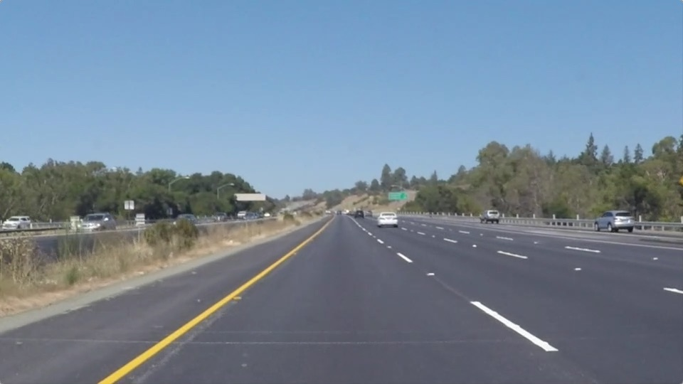 |  | 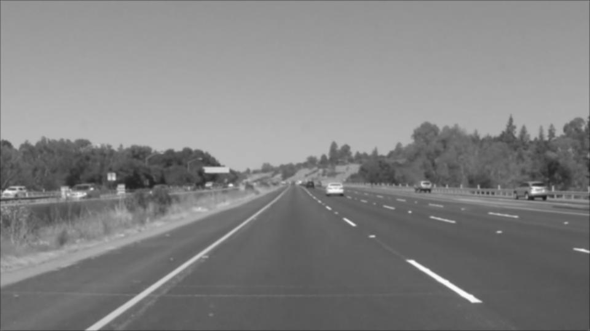 |

| 锐化 | Sobel 边缘检测 |
| :---: | :---: |
| 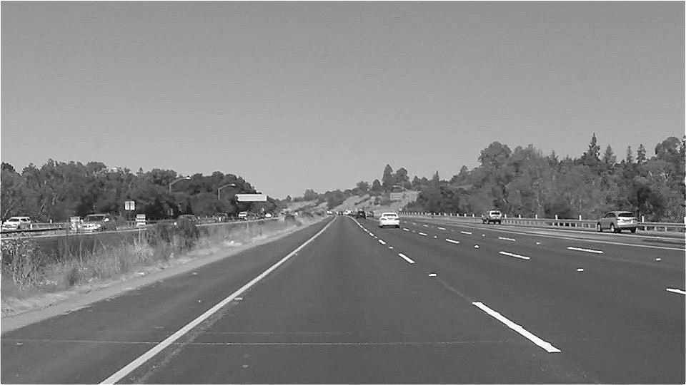 | 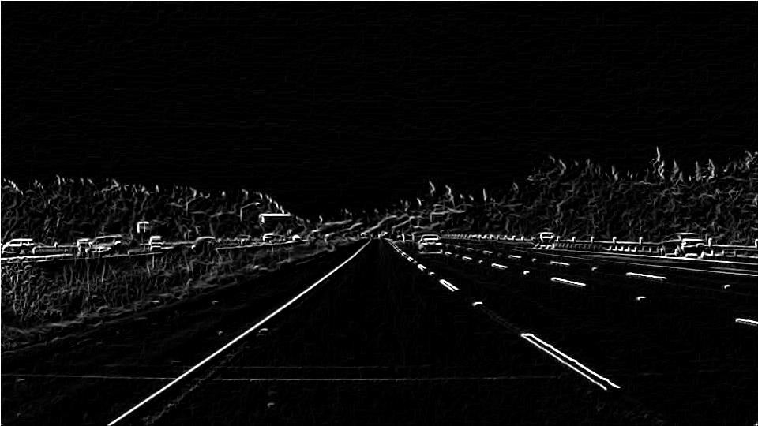 |

### 6. 效果解释
- **均值与高斯卷积**：通过计算局部平均值（或加权平均值），抹平了高频信号（噪声），导致图片变模糊。
- **锐化**：增大了中心像素的权重，并减去周围像素，增强了局部对比度，使边缘更清晰。
- **Sobel 边缘检测**：它是一个离散微分算子，计算图像像素的梯度。梯度越大的地方（颜色突变），表示是边缘，因此能找到轮廓。

### 7. Valid vs Same 及尺寸公式
- **Valid（不填充）**：原图 540x960，3x3 卷积后变成 538x958。
- **Same（填充）**：外围补一圈 0（padding=1），输出尺寸保持 540x960。
- **尺寸公式**：\(\boldsymbol{Output = \left\lfloor \frac{Input + 2\times Padding - Kernel\_size}{Stride} \right\rfloor + 1}\)
  - Input：输入特征图的**单边长度**（H 或者 W）
  - \(Padding(P)\)：在图片**四周补 0 的圈数**。左右各补 P，上下各补 P → 总共变长 2P
  - \(Kernel\_size(K)\)：卷积核单边大小（3 就是 3×3 卷积核）
  - \(Stride(S)\)：卷积核每次滑动多少像素
- **越界处理**：卷积后部分数值可能小于0或大于255，代码中使用了 `np.clip(output, 0, 255)` 进行截断，保证图像正常显示。

---

## 实践 2：训练猫狗分类器

### 1. 数据集观察
由于网络受限，使用了 PyTorch 内置的 CIFAR-10 数据集提取的猫狗子集替代。
- 训练集：8000 张，验证集：2000 张，测试集：2000 张。
- 图片尺寸统一为 32x32，背景各异，部分图片分辨率极低，肉眼难以分辨。

### 2. 数据读取与预处理展示
- **如何组成 Batch**：通过 `DataLoader`，设置 `batch_size=32`，将32张图片打包成一个形状为 `(32, 3, 32, 32)` 的张量送入模型。
- **预处理前后对比**：预处理前为原始尺寸的 PIL Image，预处理后经过 Resize、ToTensor 和 Normalize 变成了 32x32 张量。从下图可以看出，图片保持了原有特征，未出现异常拉伸、裁剪错误或颜色失真。

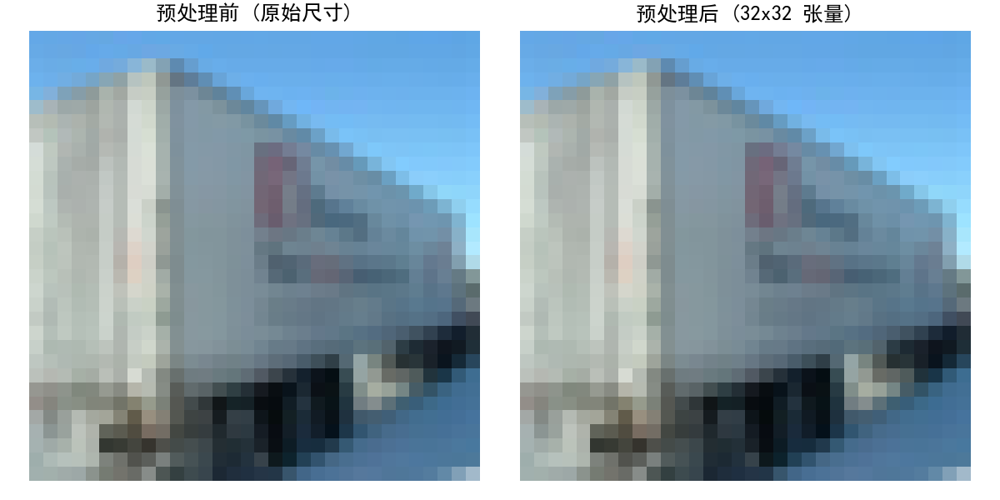

### 3. CNN 模型搭建
包含了 3 个卷积层、ReLU 激活函数和 MaxPooling 池化层。（代码见 `task2.py`）

### 4. 各层 Tensor 形状变化
- 输入：`(B, 3, 32, 32)`
- 第1层（Conv+Pool）：输出 `(B, 16, 16, 16)`，通道数增加，宽高减半。
- 第2层（Conv+Pool）：输出 `(B, 32, 8, 8)`。
- 第3层（Conv+Pool）：输出 `(B, 64, 4, 4)`。
- Flatten 展平后：`(B, 1024)`。
- 全连接层后输出：`(B, 1)`。

### 5. 特征图可视化
提取了第一层卷积（Conv1）输出的 16 个通道的部分特征图：
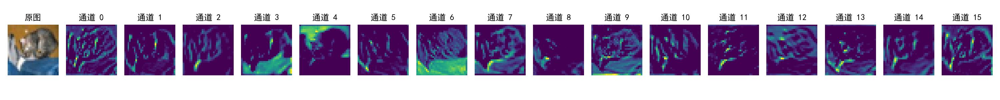

**现象分析：**
1. **轮廓与边缘响应（如通道 3、4、7）**：这些通道清晰地勾勒出了狗的身体轮廓。这说明在训练过程中，这几个卷积核的权重 \(W\) 学成了类似边缘检测器（如 Sobel 算子）的形状，专门对像素的梯度变化（明暗交界处）产生强烈响应。
2. **背景与纹理响应（如通道 13）**：注意通道 13 的左上角（高亮区域），它响应的是原图背景中草地/泥地的纹理，而不是狗本身。这说明不同的卷积核有明确的分工，有的关注主体，有的关注背景。
3. **未激活通道（如通道 0、1、6 等）**：这些特征图几乎全黑。这是因为经过卷积计算后，这些区域的数值为负数，被后面的 **ReLU 激活函数**（\(f(x)=\max(0,x)\)）直接截断成了 0。这说明该特定的卷积核在这张图里没有找到它想找的特征（比如它专门找垂直的线，但原图对应位置没有）。
4. **总结**：浅层卷积（Conv1）提取的是**底层视觉特征**（边缘、角点、纹理、颜色斑块）。随着网络层数加深（如 Conv2、Conv3），这些底层特征会被不断组合，最终形成“狗耳朵”、“狗鼻子”等**高级语义特征**，从而帮助全连接层做出分类决策。

### 6. 数据增强对照实验
设计了“无增强”与“有增强（随机水平翻转、随机旋转）”的对比实验。
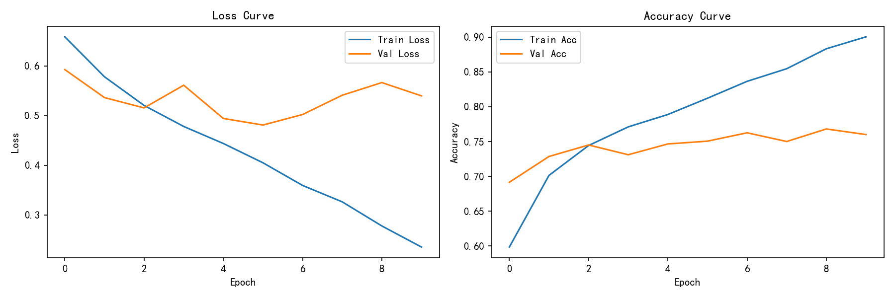
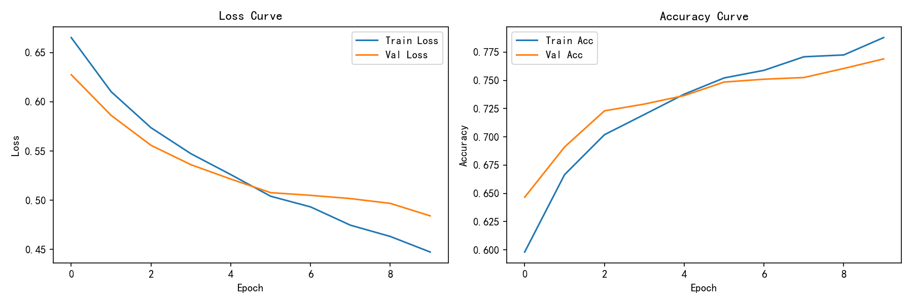
**分析**：无增强时出现了严重的过拟合（Train Acc 90%，Val Acc 仅 76%）；有增强时泛化能力明显提升，曲线更贴合。旋转和翻转是合理的，不会破坏“猫狗”的语义标签。

### 7. 错误样本分析及改进方案
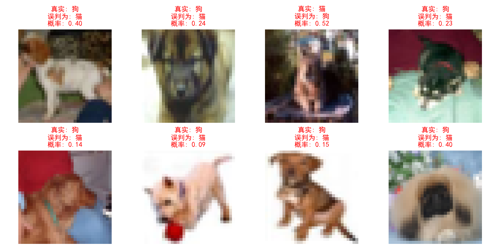

**错判现象观察：**
从挑选出的错误样本来看，模型给出的预测概率大多在 0.4~0.6 之间（例如 0.42、0.55），说明模型对这些图片非常“犹豫”，没有极端的自信。
1. **像素极低导致特征丢失**：如右下角的黑猫，在 32x32 分辨率下几乎糊成了一团黑影，肉眼也难以分辨。
2. **非典型姿态**：如第一行第三列的猫，它伸着懒腰，身体拉长，形态特征非常像狗。
3. **背景强干扰**：如第一行第二列的狗，缩在角落，背景颜色与主体高度融合，导致模型提取不到边缘特征。

**深度原因分析：**
- **数据层面**：CIFAR-10 的 32x32 分辨率限制了我们模型的“视力”。
- **模型层面**：我们的 SimpleCNN 只有 3 个卷积层，感受野有限，不足以提取出在复杂背景下的高级语义特征。

**做出的改进尝试与方案：**
1. **数据增强升级**：在现有翻转/旋转的基础上，加入 `ColorJitter`（颜色扰动），强迫模型忽略背景颜色，关注形状；或者加入 `RandomResizedCrop`，让模型习惯主体放大/缩小的不同比例。
2. **模型结构升级（迁移学习）**：放弃从头训练简单 CNN，引入预训练模型（如 ResNet18），利用其在百万级 ImageNet 上学到的强大边缘和纹理提取能力（迁移学习），稍微微调即可完胜。
3. **更换高质量数据集**：如果能换成原题要求的 Kaggle 猫狗数据集（通常图片更大、更清晰），模型的表现会有质的飞跃。

### 8. 独立推理程序
编写了 `predict.py`，加载模型并对本地图片进行预处理和推理。
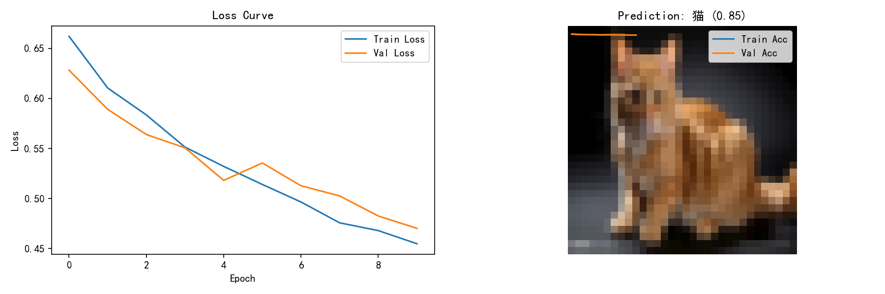
预测结果: 猫
预测概率 (置信度): 0.8503

### 9. 模型结构图

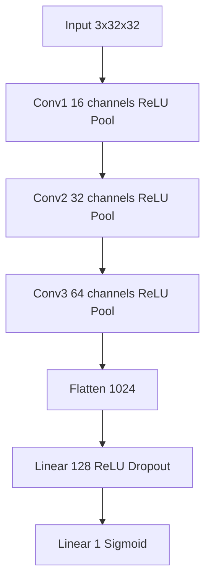

## 趁热打铁

**1. 卷积层为什么比全连接层更适合处理图片？试着用全连接层对比？**
- **理论原因**：全连接层把图像展平（如 32x32x3 = 3072），完全丢失了二维空间结构；且参数量巨大（3072 × 128 ≈ 39万参数），极易过拟合。卷积层通过**局部连接**和**权值共享**，只用了极少的参数就保留了空间特征。
- **实测对比**：我编写了一个纯全连接层（MLP）跑本任务（见 `mlp_baseline.py`），5 个 Epoch 后验证集准确率仅为 **60.75%**（基本等于瞎猜），且无法收敛；而我们的 SimpleCNN 跑 10 个 Epoch 准确率可达 **77.5%**。这证明了 CNN 在图像特征提取上具有绝对优势。

**2. 输入通道、输出通道与卷积核数量的关系？**
- **输入通道**：取决于上一层。第一层是 RGB（3通道），中间层是上一层输出的特征图数量。
- **输出通道**：由当前层的卷积核数量决定。例如 `Conv2d(3, 16, 3)`，意味着有 16 个卷积核，每个卷积核提取一种特征，最终输出 16 个通道（特征图）。

**3. padding、stride 和 pooling 如何改变尺寸？实际计算。**
- 通用公式：\(W_{out} = \lfloor \frac{W_{in} + 2P - K}{S} \rfloor + 1\)
- **实际计算**：以我们网络中的第一层为例，输入 \(32 \times 32\)，卷积核 \(K=3\)，填充 \(P=1\)，步长 \(S=1\)。代入公式：\(\frac{32 + 2 - 3}{1} + 1 = 32\)（尺寸不变）。随后接 \(2 \times 2\) 的 MaxPooling，步长为2，尺寸直接减半变为 \(16 \times 16\)。

**4. 为什么特征图的宽高越来越小，通道数却越来越多？**
- **宽高变小**：为了压缩空间冗余，减少计算量，同时让感受野（Receptive Field）变大，使网络看到更全局的信息。
- **通道变多**：空间信息被“压缩”到了通道维度，我们需要更多的通道来记录更复杂、更高级的抽象语义特征（从浅层的边缘/线条，逐渐变成深层的纹理、甚至猫耳朵、狗鼻子）。

**5. 选了啥激活函数和损失函数？为什么适合？**
- **隐藏层用 ReLU**：正区间导数为1，能有效缓解深层网络的梯度消失问题，且计算速度极快。
- **输出层用 Sigmoid**：将输出压缩到 (0, 1) 区间，代表样本属于正类的概率。
- **损失函数用 BCELoss（二分类交叉熵）**：它的数学本质（负对数似然）完美契合 Sigmoid 输出的概率，对错误预测的惩罚力度极大，能加速收敛。

**6. 数据增强为什么不能用在验证/测试集？翻转、裁剪、颜色变化可能带来什么？**
- **不能用的原因**：验证集和测试集需要提供绝对稳定的基准。如果用了随机增强，每次评估的标准都在变，得出的准确率毫无意义。测试集只能做确定的 Normalize 等操作。
- **翻转（Flip）**：通常合理，因为猫狗翻转后依然是猫狗；但如果是手写数字“6”和“9”，翻转就会破坏标签。
- **裁剪（Crop）**：能提升模型对主体位置的鲁棒性；但如果裁得太狠，把关键特征（如猫耳朵）裁掉了，会导致标签与图像不符（破坏语义）。
- **颜色变化（ColorJitter）**：能提升对光照的鲁棒性；但改变过大，可能把白狗变成黑狗，造成颜色特征严重失真。