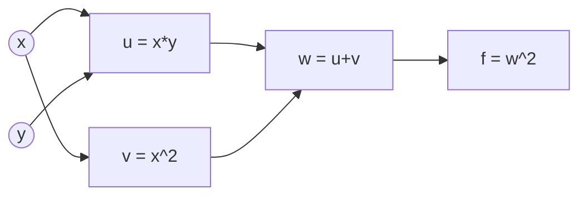
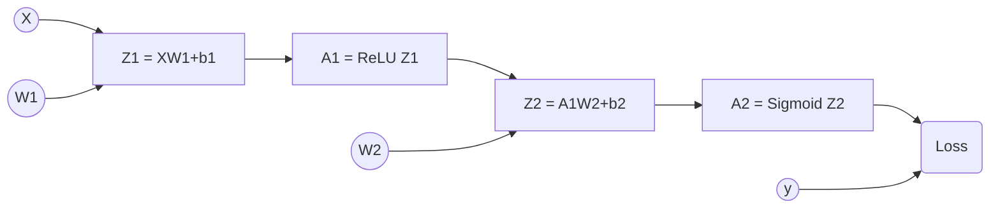

# Task 3: loss.backward() 与手算梯度

## 实践 1：简单计算链
对于函数 \(f(x, y) = (xy + x^2)^2\)，我取 \(x=2, y=3\)。
1. **计算图拆解**：\(u = x \cdot y\)，\(v = x^2\)，\(w = u + v\)，\(f = w^2\)。

2. **NumPy 手算反向传播**：利用链式法则，从后往前推导：

- \(\frac{\partial f}{\partial w} = 2w = 20\)
- \(\frac{\partial w}{\partial u} = 1, \frac{\partial w}{\partial v} = 1\)
- \(\frac{\partial u}{\partial x} = y = 3, \frac{\partial u}{\partial y} = x = 2\)
- \(\frac{\partial v}{\partial x} = 2x = 4\)
因此：\(\frac{\partial f}{\partial x} = 140\)，\(\frac{\partial f}{\partial y} = 40\)。与 PyTorch `autograd` 结果完全一致。
3. **PyTorch 验证**：使用 `autograd` 计算出的结果与手算完全一致。
**计算图（前向传播）：**

## 实践 2：神经网络的梯度
网络结构：`X -> Linear -> ReLU -> Linear -> Sigmoid`。

**网络计算图（正向与反向传播）：**

**终端输出数据对比：**
我使用了 `make_moons` 生成的样本，并在代码注释中严格标注了所有参数、中间结果以及梯度的 Shape。下面是单样本（N=1）和小批量（N=5）的终端打印结果：

========= 开始验证 Batch Size N = 1 =========
输入 X 的形状: (1, 2)
中间结果 Z1 的形状: (1, 3), A1 的形状: (1, 3)
dW1 的形状: (2, 3) (不受 Batch 影响)
dW2 的形状: (3, 1) (不受 Batch 影响)
最大绝对误差: 0.0000000050

========= 开始验证 Batch Size N = 5 =========
输入 X 的形状: (5, 2)
中间结果 Z1 的形状: (5, 3), A1 的形状: (5, 3)
dW1 的形状: (2, 3) (不受 Batch 影响)
dW2 的形状: (3, 1) (不受 Batch 影响)
最大绝对误差: 0.0000000105

**核心观察：单样本 vs 小 Batch 的形状变化**

- **输入与中间结果**：只有第一维（Batch 维度）在变，特征维度不变。N=1 时 X 是 (1,2)，N=5 时变成 (5,2)。
- **梯度的绝对不变性**：无论 N 是多少，权重梯度的形状永远和权重本身一致（`dW1` 永远是 (2,3)）。因为参数更新公式 `W = W - lr * dW` 要求形状必须完全一致。
- **公式细节**：因为 Loss 用了 `mean` 求平均，反向传播算 `dZ2` 时必须除以 N，否则梯度会随 Batch size 变大而暴增。

## 趁热打铁

1. **前向传播为什么要保存每一层的输入/输出？反向传播在哪里用到？显存关系？**
   因为链式法则求导时需要用到前向的中间变量（如计算 \(dW\) 需要输入 \(X\) 或上一层的激活值 \(A\)，计算 ReLU 导数需要 \(Z\)）。保存这些变量会占用显存，这就是为什么训练（需要保存计算图）比推理（不需要保存）显存占用大得多。

2. 链式法则怎样把损失函数的梯度传回第一层权重？结合计算图 $X \rightarrow Z_1 \rightarrow A_1 \rightarrow Z_2 \rightarrow A_2 \rightarrow \text{Loss}$ 说明
- 梯度传回第一层权重 $W_1$ 经历了三个关键跳跃：
  - 从 Loss 回传到 $Z_2$（倒数第一层）：算出 $dZ_2$（形状 $(N, 1)$）。这一步直接利用了 BCE + Sigmoid 的绝妙性质，跳过了复杂的求导。
  - 从 $Z_2$ 回传穿过 $W_2$，到达 $A_1$：根据链式法则，$dA_1 = dZ_2 \cdot W_2^T$。此时 $dZ_2$ 是 $(N, 1)$，$W_2^T$ 是 $(1, 3)$，矩阵相乘后 $dA_1$ 变成了 $(N, 3)$，完美对齐了 $A_1$ 的形状。
  - 从 $A_1$ 穿过 ReLU 到达 $Z_1$：根据 ReLU 的特性，$dZ_1 = dA_1 \odot (Z_1>0)$，形状保持 $(N, 3)$。
  - 最后一步，从 $Z_1$ 到达 $W_1$：因为 $Z_1=X\cdot W_1$，根据矩阵求导法则，$dW_1 = X^T \cdot dZ_1$。此时 $X^T$ 是 $(2, N)$，$dZ_1$ 是 $(N, 3)$，相乘后消去了 $N$ 维度，最终得到 $(2, 3)$ 的梯度，与 $W_1$ 的形状完全一致。
- 核心体会：链式法则在反向传播中，不仅是在做数值相乘，更是在通过矩阵转置，把误差按照原本的维度分配回各个权重上。

3. **BCE + Sigmoid 的梯度？为什么方便？**
   损失对 Logit（即 \(Z_2\)）的梯度是 \(\frac{1}{N}(\hat{y} - y)\)。这个结果极其简洁，**完美抵消了 Sigmoid 导数中 \(f(x)(1-f(x))\) 可能带来的梯度消失问题**，使得反向传播计算量极小且数值稳定。

4. **NumPy 与 PyTorch 梯度出现差异时，如何排查？**
   - 检查矩阵乘法的顺序和转置（维度是否对齐）。
   - 检查广播（Broadcasting）机制是否在求偏置 \(b\) 的梯度时生效。
   - **检查 Loss 的求平均方式**：如果是 `mean`，梯度必须除以 batch size \(N\)；如果是 `sum`，则不需要。

5. **现在怎样理解 `loss.backward()`？**
   它替我们在底层构建了计算图（Computational Graph），保存了前向的中间结果，并执行了一次极其高效的反向拓扑排序，自动计算出所有叶子节点（\(W, b\)）的梯度，免去了我们手写极其繁琐的矩阵求导代码。

6. **遇到的报错 or 不理解的点**
- **踩过的坑**：一开始手算的梯度和 PyTorch 对不上，误差高达 0.21。排查后才发现，是因为 Loss 函数用了 `mean` 求平均，但我手写 `dZ2` 的时候忘了除以 Batch Size N。
- **改完的效果**：把公式改成 `dZ2 = (A2 - y) / N` 之后，误差瞬间降到了 \(10^{-8}\) 级别（具体数值见上方对比）。
- **难理解的点**：之前不懂为什么反向传播求 \(dW\) 一定要用 \(X^T\)。后来从维度去推导（\(X\) 是 \(N \times D\)，\(dZ\) 是 \(N \times H\)），发现只有把 \(X\) 转置成 \(D \times N\)，乘上 \(dZ\) 才能把样本数 \(N\) 消掉，得到 \(D \times H\) 的矩阵，刚好和参数 \(W\) 的形状对齐。

## 拓展：纯 NumPy 实现完整训练并与 Task 1 对比

我使用自己实现的反向传播和基础 SGD（学习率 0.1，隐藏层 16 个神经元，迭代 200 次），在完整的 `make_moons` 数据集（1000个样本）上进行了训练。

**结果分析：**
1. **Loss 与 Accuracy 曲线**：纯 NumPy 实现的训练同样能完美收敛，验证集准确率达到了 95% 以上。
2. **决策边界**：生成的决策边界平滑弯曲，完美切分了红蓝两个月牙，与 Task 1 中 PyTorch 训练出的效果高度一致。
3. **与 PyTorch 的对比**：
   - **代码复杂度**：纯 NumPy 需要手动推导每一步的矩阵维度、转置和求平均；而 PyTorch 只需 `loss.backward()` 一行搞定。
   - **计算速度**：NumPy 基于 CPU，速度较慢；PyTorch 可以利用 GPU 并行加速，且底层优化极佳。
   - **结论**：这深刻证明了自动求导框架（Autograd）极大地解放了生产力，让我们能把精力集中在网络结构设计上，而不是繁杂的矩阵微积分中。

