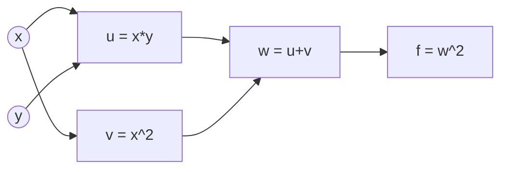
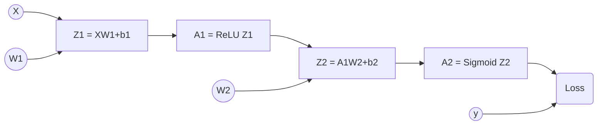
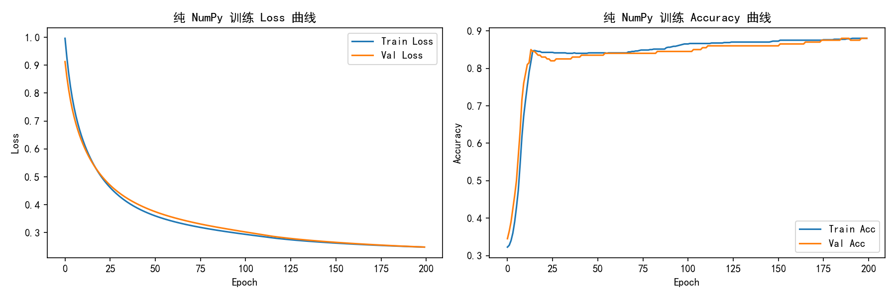
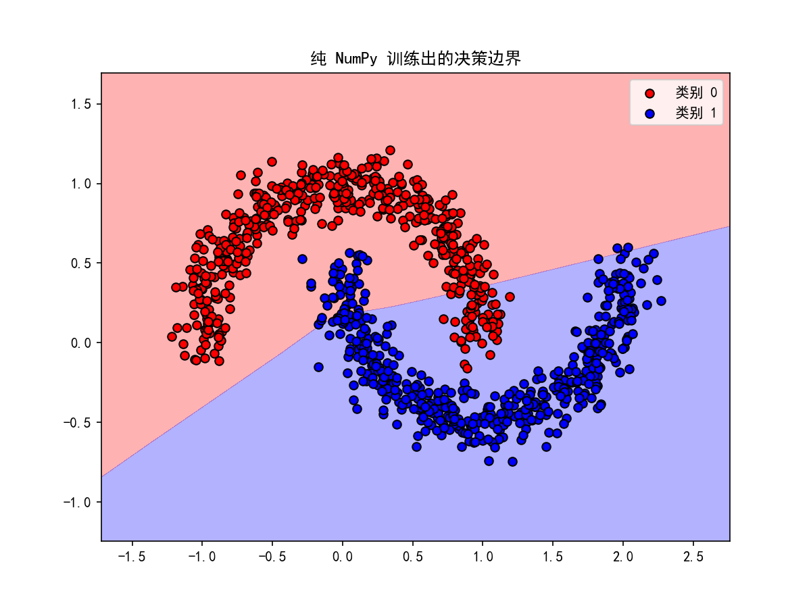

# Task 3: loss.backward() 与手算梯度

## 实践 1：简单计算链
对于函数 \(f(x, y) = (xy + x^2)^2\)，我取 \(x=2, y=3\)。
1. **计算图拆解**：\(u = x \cdot y\)，\(v = x^2\)，\(w = u + v\)，\(f = w^2\)。

2. **NumPy 手算反向传播**：利用链式法则，从后往前推导，得出 \(\frac{\partial f}{\partial x} = 140\)，\(\frac{\partial f}{\partial y} = 40\)。
3. **PyTorch 验证**：使用 `autograd` 计算出的结果与手算完全一致。
**计算图（前向传播）：**

## 实践 2：神经网络的梯度
网络结构：`X -> Linear -> ReLU -> Linear -> Sigmoid`。

**网络计算图（正向与反向传播）：**

1. 实现细节：我使用了 make_moons 生成的样本，并在代码注释中严格标注了所有参数、中间结果以及梯度的 Shape。
2. 对比验证：使用纯 NumPy 实现了前向传播和链式法则的反向传播。并与 PyTorch 的 .grad 逐项对比，最大绝对误差在1e−8 级别，形状完全一致。
3. 核心观察：单样本 vs 小 Batch 的形状变化
- 通过对比 \(N=1\) 和 \(N=5\) 的情况：
  - 输入与中间结果：当 \(N=1\) 时，X 为 (1,2)，\(Z_1\) 为 (1,3)；当 \(N=5\) 时，X 变成 (5,2)，\(Z_1\) 变成 (5,3)。只有 Batch 维度变化，特征维度不变。
  - 梯度的绝对不变性：无论 N 是多少，权重梯度的形状永远与权重矩阵本身一致（\(dW_1\) 始终为 (2,3)，\(dW_2\) 始终为 (3,1)）。这是因为更新参数时要求形状匹配。
  - 公式变化：由于 Loss 使用了 mean 求平均，反向传播求 \(dZ_2\) 时，必须除以 N。如果不除，梯度值会随 Batch 变大而放大，导致更新步长失控。

*(代码及中间维度的 Shape 详见 `task3.py` 中的注释)*

## 趁热打铁

1. **前向传播为什么要保存每一层的输入/输出？反向传播在哪里用到？显存关系？**
   因为链式法则求导时需要用到前向的中间变量（如计算 \(dW\) 需要输入 \(X\) 或上一层的激活值 \(A\)，计算 ReLU 导数需要 \(Z\)）。保存这些变量会占用显存，这就是为什么训练（需要保存计算图）比推理（不需要保存）显存占用大得多。

2. 链式法则怎样把损失函数的梯度传回第一层权重？结合计算图 $X \rightarrow Z_1 \rightarrow A_1 \rightarrow Z_2 \rightarrow A_2 \rightarrow \text{Loss}$ 说明
- 梯度传回第一层权重 $W_1$ 经历了三个关键跳跃：
  - 从 Loss 回传到 $Z_2$（倒数第一层）：算出 $dZ_2$（形状 $(N, 1)$）。这一步直接利用了 BCE + Sigmoid 的绝妙性质，跳过了复杂的求导。
  - 从 $Z_2$ 回传穿过 $W_2$，到达 $A_1$：根据链式法则，$dA_1 = dZ_2 \cdot W_2^T$。此时 $dZ_2$ 是 $(N, 1)$，$W_2^T$ 是 $(1, 3)$，矩阵相乘后 $dA_1$ 变成了 $(N, 3)$，完美对齐了 $A_1$ 的形状。
  - 从 $A_1$ 穿过 ReLU 到达 $Z_1$：根据 ReLU 的特性，$dZ_1 = dA_1 \odot (Z_1>0)$，形状保持 $(N, 3)$。
  - 最后一步，从 $Z_1$ 到达 $W_1$：因为 $Z_1=X\cdot W_1$，根据矩阵求导法则，$dW_1 = X^T \cdot dZ_1$。此时 $X^T$ 是 $(2, N)$，$dZ_1$ 是 $(N, 3)$，相乘后消去了 $N$ 维度，最终得到 $(2, 3)$ 的梯度，与 $W_1$ 的形状完全一致。
- 核心体会：链式法则在反向传播中，不仅是在做数值相乘，更是在通过矩阵转置，把误差按照原本的维度分配回各个权重上。

3. **BCE + Sigmoid 的梯度？为什么方便？**
   损失对 Logit（即 \(Z_2\)）的梯度是 \(\frac{1}{N}(\hat{y} - y)\)。这个结果极其简洁，**完美抵消了 Sigmoid 导数中 \(f(x)(1-f(x))\) 可能带来的梯度消失问题**，使得反向传播计算量极小且数值稳定。

4. **NumPy 与 PyTorch 梯度出现差异时，如何排查？**
   - 检查矩阵乘法的顺序和转置（维度是否对齐）。
   - 检查广播（Broadcasting）机制是否在求偏置 \(b\) 的梯度时生效。
   - **检查 Loss 的求平均方式**：如果是 `mean`，梯度必须除以 batch size \(N\)；如果是 `sum`，则不需要。

5. **现在怎样理解 `loss.backward()`？**
   它替我们在底层构建了计算图（Computational Graph），保存了前向的中间结果，并执行了一次极其高效的反向拓扑排序，自动计算出所有叶子节点（\(W, b\)）的梯度，免去了我们手写极其繁琐的矩阵求导代码。

## 拓展：纯 NumPy 实现完整训练

我使用自己实现的反向传播和基础 SGD（学习率 0.1，隐藏层 16 个神经元，迭代 200 次），在完整的 `make_moons` 训练集（800个样本）上进行了训练。

**结果分析：**
1. 纯 NumPy 训练出的决策边界同样弯曲且完美切分了红蓝点，与 Task 1 的 PyTorch 模型效果高度一致。
2. **速度对比**：纯 NumPy 的代码执行速度明显较慢，且需要我们手动管理所有矩阵维度和梯度除法。这深刻体现了 PyTorch 自动求导框架和 GPU 并行加速的强大与便捷。

