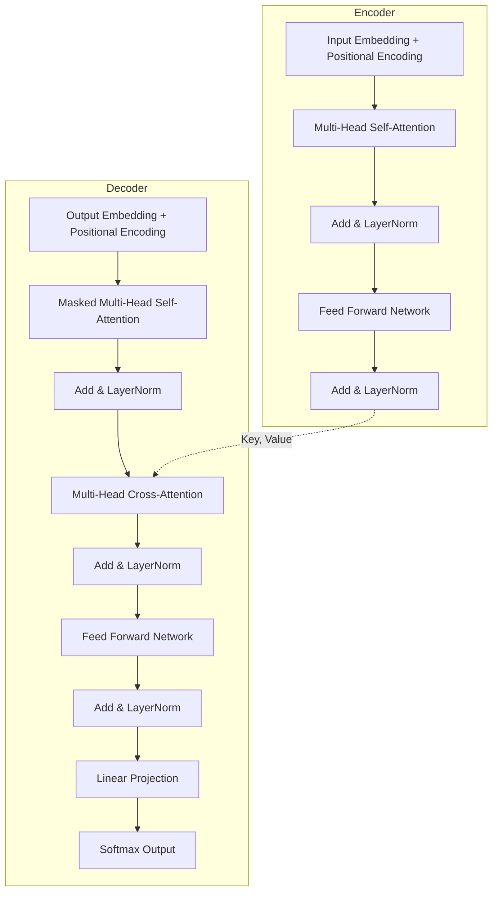
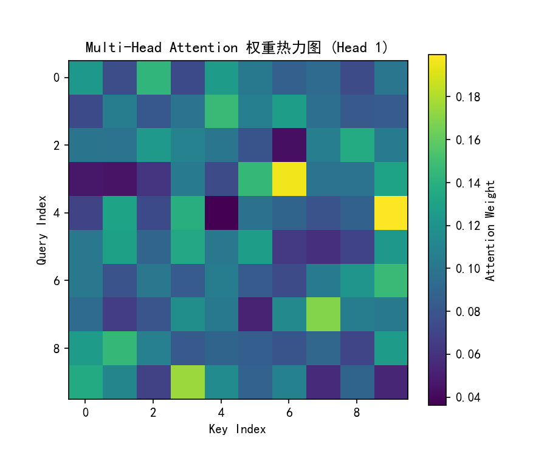

# Task 4: All you need is attention?! 阅读笔记与代码实现

## 一、 Transformer 简化结构图
使用 Mermaid 重新绘制了简化的 Transformer 架构图，突出了数据流向和多头注意力的位置：

## 二、 论文核心思考题解答
**1. 论文最初处理什么任务？为什么不用 RNN 和 CNN？**
- **任务**：机器翻译（英译法）。
- **不用 RNN**：RNN 必须串行计算，无法并行；且序列过长时存在长距离依赖衰减问题。
- **不用 CNN**：CNN 只能看到局部感受野，必须通过堆叠很多层才能捕捉全局信息。
- **Transformer 优势**：通过 Attention 机制，任意两个位置的距离为 $O(1)$，彻底解决了长距离依赖，且高度支持并行化。

**2. Self-Attention 中的 "Self" 是什么意思？**
- "Self" 意味着 Query、Key、Value 这三者**全部来自同一个输入序列**（上一层输出）。它计算的是**同一个句子内部**，各个词之间的相互关系权重。

**3. Q、K、V 分别来自哪里？为什么要经过不同的线性变换？**
- **来源**：都是同一个输入矩阵 $X$ 乘以不同的权重矩阵（$W^Q, W^K, W^V$）。
- **原因**：如果不做映射，相当于在同一个特征空间里自己和自己比较。乘以不同的 $W$，相当于把 $X$ 投影到了不同的子空间，让 $Q$ 负责"查询"，$K$ 负责"被匹配"，$V$ 负责"提供实际内容"，极大增强了表达能力。

**4. Attention 的结果为什么要经过 softmax？得到的每一行权重表示什么？**
- $Q$ 和 $K^T$ 点积出来的 scores 是实数，可正可负。Softmax 将其转化为 $(0, 1)$ 之间的概率分布，且每一行之和为 1。
- **物理意义**：每一行代表当前这个词（Query），对整个序列中所有词（Keys）的**关注程度（重要性分配）**。

**5. Multi-Head Attention 为什么要分成多个头？**
- 不同的头将输入映射到不同的子空间，并行计算。一个头可能关注语法特征（如主谓一致），另一个头可能关注指代关系（如代词指代谁）。最后拼接起来，相当于综合了不同视角的特征，而不是把同一件事重复多次。

**6. Transformer 没有循环结构，怎样知道词语先后顺序？**
- 使用 **Positional Encoding（位置编码）**。因为 Self-Attention 具有置换不变性（打乱输入，结果不变），必须引入绝对或相对位置编码。论文使用了不同频率的 sin 和 cos 函数。

**7. Decoder 中为什么需要 Masked Attention？**
- 因为 Decoder 在训练时是并行输入的，但在推理时是自回归（一个个生成）的。如果不 Mask（将未来位置置为负无穷），模型在预测第 $t$ 个词时就会"看到"后面的答案，造成信息泄漏（作弊）。

**8. 残差连接、Layer Normalization 和 FFN 分别在哪？起什么作用？**
- **残差连接（Add）**：包裹在每个子层外（$x + Sublayer(x)$）。提供梯度高速公路，缓解深层网络梯度消失。
- **LayerNorm（Norm）**：在残差后。对每个样本的特征维度求均值和方差，稳定分布，加速收敛。
- **FFN**：两层线性层夹一个 ReLU。作用是引入非线性变换，增强模型拟合复杂函数的能力。

## 三、 拓展题：手写 Attention 代码
使用纯 PyTorch 实现了单头和多头 Scaled Dot-Product Attention（未调用 `nn.MultiheadAttention`）。
- **代码文件**：见 `attention.py`。
- **实现逻辑**：
  1. 计算 $Q$ 与 $K^T$ 的点积，除以 $\sqrt{d_k}$ 进行缩放。
  2. 经过 Softmax 得到注意力权重矩阵。
  3. 将权重与 $V$ 矩阵相乘。
  4. 多头拆分与拼接：将 `(B, L, 512)` 变换为 `(B, 8, L, 64)`，并行计算后再拼回 `(B, L, 512)`。
- **测试结果**：输入 `(1, 10, 512)`，输出 `(1, 10, 512)`，注意力权重为 `(1, 8, 10, 10)`。热力图如下：
