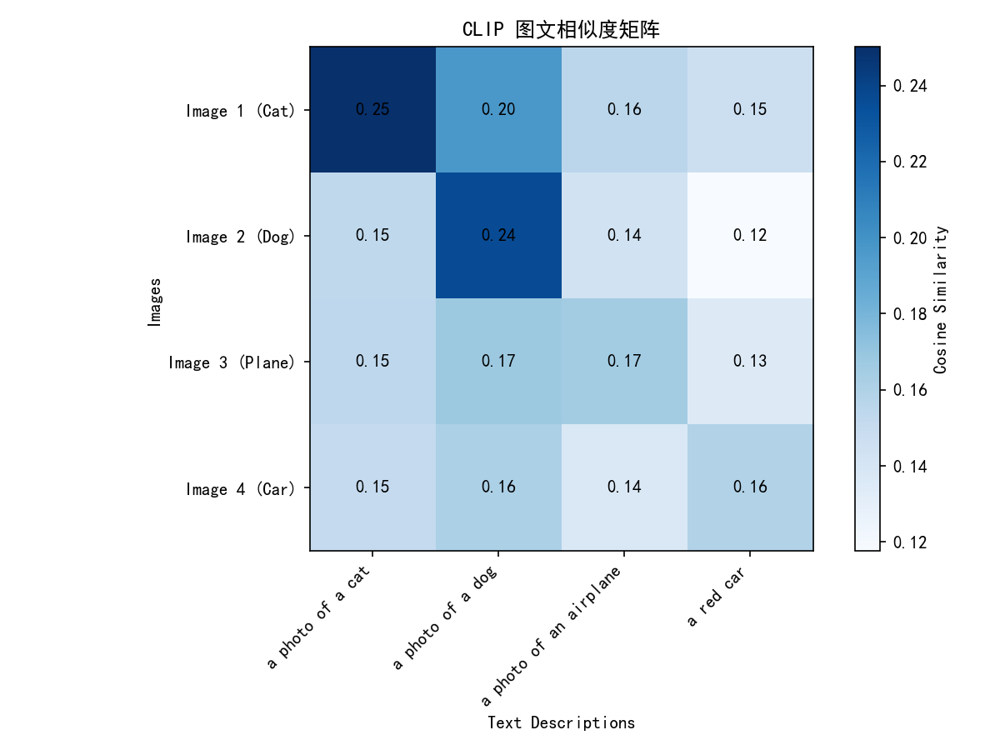

# Task 5: CLIP 论文阅读与实验

## 一、 任务1：CLIP 论文阅读笔记

1. **传统模型与 CLIP 的数据差异**
   以前做图像分类，必须人工给图片打标签（比如 ImageNet），类别是固定的，加个新类别就要重新标数据、重新训练。CLIP 不一样，它直接抓取互联网上现成的“图片+旁边的文字”来训练。因为网上的数据量大，而且文本是自然语言，所以模型见多识广，打破了固定类别的限制。

2. **两个编码器**
   CLIP 包括一个图像编码器（可以是 ResNet 或 ViT）和一个文本编码器（Transformer）。图片进去出来变成图像向量；文字进去出来变成文本向量。

3. **什么是图文对齐**
   就是让语义一致的图片和文本，在多维向量空间里靠得更近。比如一张猫的图片和“a cat”这句话，算出来的两个向量夹角要尽量小。

4. **N*N 配对（结合 Figure 1）**
   假设一个 batch 里有 N 张图和 N 段文字。让每张图都去和每段文字算相似度，就会得到一个 N*N 的矩阵。
   - 正样本：对角线上的 N 个（正确的图文对）。
   - 负样本：非对角线的 \(N^2 - N\) 个（乱配的图文对）。

5. **训练目标与实现**
   目标就是让对角线（正样本）的分数尽可能高，非对角线（负样本）的分数尽可能低。用的是对比学习（InfoNCE Loss），本质上就是拿相似度矩阵去算一个交叉熵，强行把原配的图文拉近，把错配的推远。

6. **Zero-shot classification（零样本分类）**
   就是模型不需要用新数据重新训练。比如要新识别“斑马”，只要把“a photo of a zebra”变成文本向量，然后去和图片库对比，哪张图跟这个文本向量最接近，就猜它是斑马。

7. **Prompt engineering（提示词工程）**
   如果只输入 "dog"，可能效果不好，因为训练数据里的句子一般都很完整。换成 "a photo of a dog" 就更符合训练分布。论文里还发现，针对不同任务加不同的前缀，准确率能提升不少。

8. **限制与数据偏见**
   CLIP 没法做复杂的逻辑推理。而且互联网数据有很多偏见，比如“雪地”总是和“北极熊”一起出现，模型就会走捷径，只要看到雪地就猜北极熊。这反映出大模型训练的一个重要思想：数据质量决定了模型上限，如果数据有偏见，模型就一定会有偏见。

---

## 二、 任务2：代码实验与结果分析

**实验配置**：使用了 OpenAI CLIP 的 RN50 模型。使用 4 张图片，输入尺寸处理成 224x224。
**图片来源**：全部来自 Unsplash 公开图库，链接如下：
- 猫：`https://images.unsplash.com/photo-1514888286974-6c03e2ca1dba`
- 狗：`https://images.unsplash.com/photo-1543466835-00a7907e9de1`
- 飞机：`https://images.unsplash.com/photo-1559825481-12a05cc00344`
- 汽车：`https://images.unsplash.com/photo-1494976388531-d1058494cdd8`

并故意把第四句文本写错成 "a red car"（原图是银灰色的汽车），测试模型能否分辨错误属性。

**代码输出**：
- 图像特征形状: `torch.Size([4, 1024])`
- 文本特征形状: `torch.Size([4, 1024])`
（RN50 图像输出是 1024 维，文本编码器也会通过线性层映射到 1024 维，这样两者才能算点积）。

**结果观察**：

从热力图来看：
**配对成功与失败的原因分析**：
1. **成功案例（猫、狗）**：猫图与 "a photo of a cat" 得分 0.25，狗图与 "a photo of a dog" 得分 0.24，均是该行最高分。这说明 CLIP 抓住了“猫/狗”的显著视觉特征（如耳朵、体态），成功将图文对齐。
2. **失败/并列案例（飞机）**：Image 3（飞机）在 "a photo of a dog" 和 "a photo of an airplane" 上的得分居然都是 0.17，出现了并列。这可能是因为飞机图片背景里有大片天空/云朵，且飞机形态较远，视觉特征没有极其典型的“飞机”排他性。
3. **错误描述的惩罚（汽车）**：Image 4 的得分整体偏低（最高 0.16）。虽然 "a red car" 和 "a photo of a dog" 并列了 0.16，但相比于前两列的 0.25 和 0.24，整体相似度明显下降。这说明 CLIP 对颜色属性非常敏感，原图不是红色，强行说 "red" 会拉低相似度。

## 三、 趁热打铁

1. **为什么图文特征能算相似度？需要满足什么条件？**
   因为它们是在同一个高维特征空间里比较。条件就是编码器输出的维度必须一致，并且在训练时被对比损失函数强行拉近过。

2. **为什么要做 L2 归一化？**
   向量长度不同会影响点积的大小。把长度缩放为 1 之后，点积就等于余弦相似度，这样算出来的数值只受方向（即语义夹角）影响，排除了向量长度带来的干扰。

3. **为什么要从两个方向计算损失？**
   如果只算 Image 找 Text 的 loss，文本编码器可能根本没更新好。双向算 loss，才能保证两个编码器都在被优化，互相靠拢。

4. **Zero-shot 真的完全没见过吗？**
   实际上可能见过类似的，但它的核心区别在于：做 zero-shot 的时候，**不更新模型任何参数**，纯靠前向推理，这证明它的泛化能力很强。

5. **温度系数（Temperature）有什么用？**
   它相当于一个缩放因子。把这个系数变大，softmax 后的概率分布更平滑，模型比较犹豫；系数变小，概率分布更尖锐，模型非常自信。这能让模型更快拉开正负样本的差距。

6. **数据偏见的影响？**
   如果数据总把“雪地”和“北极熊”绑在一起，模型就会走捷径，遇到雪地就猜北极熊。真实场景里（比如医疗诊断）这可能会造成致命误判。

7. **应用场景**
   - 不训练直接做图像分类。
   - 搜图：根据文本描述找图片。
   - 作为多模态模型（如 ViT、Stable Diffusion）的文本-图像对齐特征提取器。